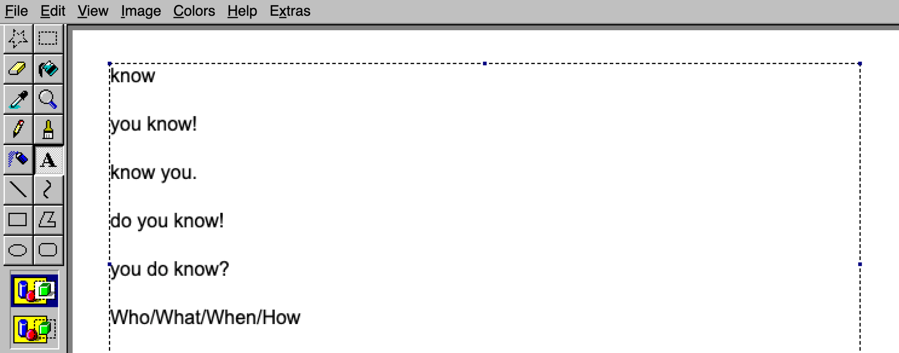

atharva naveen's personal site
<p align="center">
  
  </p><p align="center">
    <em>a living personal site for projects, writing, collections, small games, and the parts of a résumé that do not fit neatly in one line.</em>
    </p><p align="center">
      <a href="RELEASES.md">release ledger</a>
        ·
          <a href="archive/site-exports/RELEASE-ARCHIVE.md">pre-Git archive register</a>
            ·
              <a href="assets/source/README.md">source-media notes</a>
              </p>what this is
              This has never been meant to be a conventional one-page portfolio. The original project notes describe it as a personal space first: a place for different interests, changing designs, layouts, animations, and features to sit beside each other without pretending that one polished professional template tells the whole story.

              That is still the right way to read it. The site combines activity folders, writing, a denim archive, a sports archive, a browser arcade, a 100-song mixtape, an intentionally strange video interaction, a local guestbook, and a Paint-shaped opening screen. Some of those things are useful in a familiar portfolio way. Some are mostly there because a personal site gets more interesting when it can be a little playful.

              There is no claim here that this is a final version. The preserved exports make the opposite point pretty clearly: the project has changed shape repeatedly, and keeping the older versions is part of the project rather than clutter to hide.
              Current snapshot: this is a static HTML, CSS, and JavaScript site. The root page and the matching <code>dist/</code> copy use the same checked-in HTML, CSS, and JavaScript at the time this README was reviewed. There is no package install or runtime build step.

              This README is deliberately evidence-led. It was written from the current codebase, Git history, the retained source media, the archive register, and the existing release notes. There are no project-specific development recordings in this checkout, so this page does not invent a video-by-video build narrative that the project cannot support.
              the site at a glance
              area  what is currently in the site important boundary or limitation
              opening screen  A Paint-like desktop opening with clickable hotspots, window chrome, and a route into the rest of the site. It is a custom site interface, not a full local paint program.
              activity portfolio  Ten interactive folder entries that surface projects, activities, and portfolio material. The cards present the site's own portfolio content. This README does not recast those claims as independently audited records.
              denim archive Eight image-based denim entries with selection and detail states. The current data keeps a number and name, while company, style, price, and provenance are intentionally shown as unknown rather than filled in with guesses.
              sports archive  Seven selectable clothing pieces arranged as a collage, plus five collection boards for rugby, club shirts, Texas and Dallas, national teams, and basketball. It is a visual archive first. Purchase dates, prices, and fuller story notes are not recorded in the present data.
              writing Two interactive readers: <em>Consumerism, Fast Fashion, and the facade of ESG: A Global Crisis of Equity and Ecology</em> and <em>Education Inequalities</em>. Local PDF downloads are included.  The contest placement labels are site content. The README verifies that the local PDF assets are wired into the current page, not the outside contest records.
              arcade  Eleven local canvas games: Tetris, URL Snake, PinPog, Minesweeper, 2048, Breakout, Memory, Connect Four, Maze Chase, Space Invaders, and Flappy Bird. Scores and per-game state live in the current browser through local storage. The card-level source links stay close to the relevant games in the interface.
              Metro Vice  A separate 2D city sandbox linked from the Arcade.  The page exists at <code>dist/gta-2d.html</code>, not at the repository root. That makes the root preview's Metro Vice card a known missing-target issue. Details are documented below rather than buried.
              Big Questions A click-to-play local video with a poster and a deliberate error-popup treatment after playback.  The visual error treatment is intentional. It is not evidence of a failed video load.
              mixtape A 100-track browser interface with search, previous, next, shuffle, cover art, and a Spotify embed that is only loaded when the section opens.  Spotify playback needs network access and Spotify's own availability.
              guestbook and secrets A note form, pixel doodle canvas, user preferences, high scores, and small hidden interactions. They are browser-local. There is no shared backend, database, login, or real multi-user guestbook.


              two actual site artifacts
              <p align="center">
                
                  
                  </p>These are repository assets used by the site itself, not replacement mockups made for the README. The first belongs to the Big Questions interaction. The second is the opening artwork behind the home-screen hotspots.
                  the development story, without making up a cleaner one
                  1. before Git: lots of exports, not one straight line
                  The oldest part of the record is the export archive in <a href="archive/site-exports/">archive/site-exports/</a>. Its register identifies 64 unique HTML exports from the pre-Git period. They include early homepage variants, different portfolio and writing directions, Paint and arcade experiments, mascot work, sports and collection pages, and a series of fuller "living résumé" snapshots.

                  The archive is useful, but it has a real limitation: filenames and numbered families can suggest a rough order, not a trustworthy timeline of exact creation dates. The archive register says that directly. This README therefore treats the exports as evidence of exploration, not as a fake precise release calendar.

                  Keeping them matters anyway. You can see the site's core idea survive through the changes: this is not just a page of links. It is a space where personal interests, essays, collection pages, and interactive experiments are supposed to coexist.
                  2. the first repository version preserved a canonical page
                  On November 16, 2026, the project moved into Git. The earliest commits brought in a canonical site export, the original source media, and documentation for both. That made the current project more editable and gave the older material a permanent reference point instead of leaving it as a pile of unnamed local files.

                  The source folders are still preserved under <a href="assets/source/">assets/source/</a>. They include the denim, jerseys, and Descreened image collections that match sections of the page. Those are useful both as project history and as a safeguard against losing the original inputs behind the site visuals.
                  3. Big Questions was an actual iteration, not just a decorative section
                  The Git record on November 18 documents the Big Questions interaction being added, its media being brought in, and its popup asset being corrected. The current implementation keeps the mechanics local:
                  - <code>assets/media/big-questions.mp4</code> is deferred with <code>preload="none"</code>.
                  - <code>assets/media/big-questions-poster.png</code> is the poster and fallback visual.
                  - Once playback ends, the site captures a frame when the browser allows it and uses that image in its intentionally glitchy error-popup sequence. If the frame capture cannot happen, it falls back to the poster instead.
                  That fallback is a small but meaningful choice. The interaction gets to keep its intended ending even when canvas capture is unavailable.
                  4. some experiments stayed, and some stayed only in the history
                  The November 22 history includes City Heist and Metro Vice arcade experiments. The standalone root-level <code>gta-2d.html</code> was later deleted, while <code>dist/gta-2d.html</code> remains in the deployment-shaped copy and the Arcade still links to <code>gta-2d.html</code>.

                  That leaves a concrete current mismatch:
                  - Serving the repository root makes all local href targets resolve except <code>gta-2d.html</code>.
                  - Serving <code>dist/</code> makes all local href targets in its <code>index.html</code> resolve, including Metro Vice.
                  This is not a hypothetical concern. A local link scan during this README review found exactly that one root-level missing target. It is listed as a repair item below.
                  5. the important refactor was moving away from one huge page
                  The canonical export was originally a much more self-contained document. The current version split the live presentation into a small HTML shell plus linked CSS and JavaScript:
                  current file  responsibility
                  <code>index.html</code> page structure, content, route containers, media elements, semantic labels, and the accessible shell
                  <code>assets/css/site.css</code>  visual language, desktop and mobile layout, responsive states, reduced-motion behavior, focus styling, and animation
                  <code>assets/js/site.js</code>  section routing, overlays, collections, readers, games, search, guestbook, media behavior, synth effects, and browser-local state


                  The Git history records that extraction and cleanup in the commits around <code>a28f781</code>, <code>077d444</code>, and <code>2d168aa</code>. This was not only a tidier file layout. It made it possible to test JavaScript syntax on its own, retain generated assets as normal files, and reason about the site without scrolling through one giant embedded document.
                  6. asset extraction had a real edge case
                  The site originally carried media and essay PDFs through embedded data. Extraction utilities moved those pieces into <code>assets/generated/</code>, but the work exposed a subtle issue: one PDF path was assembled dynamically for a reader action, so a simple pattern replacement did not preserve it correctly at first.

                  The sequence is visible in the history:
                  - <code>5136d87</code> preserved template interpolations during extraction.
                  - <code>b7c0541</code> reused the essay PDFs instead of keeping base64 copies.
                  - <code>bf17c17</code> fixed the dynamic PDF URL extraction path.
                  - <code>ce22bf2</code> added a regression fixture for the extractor.
                  There is no invented dramatic crash log here. The evidence is the committed fix and the test that now covers the path. That is enough to describe the lesson honestly: transformations need to account for both obvious literal assets and URLs built at runtime.
                  7. the page got cheaper to load in a few targeted places
                  The denim archive uses native lazy image loading and asynchronous decoding. The Paint iframe and Spotify iframe are not given a source until their sections are opened. The arcade cancels its animation frame when the arcade is hidden. The Big Questions video is deferred until someone actually wants to play it.

                  Those are small choices, but they fit the project better than loading every image, player, canvas loop, and external embed immediately on first paint.
                  how the current site fits together
                  ```mermaid
                  flowchart TD
                      B["browser"] --> H["index.html"]
                          H --> C["assets/css/site.css"]
                              H --> J["assets/js/site.js"]
                                  H --> M["local images, PDFs, and video"]
                                      J --> L["browser localStorage"]
                                          J -. loads when opened .-> X["Spotify and JS Paint"]
                                              D["dist/"] --> P["static deployment-shaped copy"]
                                              ```
                                              The architecture is intentionally plain:
                                              - There is no framework, package manifest, bundler, database, or server application.
                                              - Hash routes let a visitor navigate sections, game views, and history without a router dependency. The script listens for hash and history changes and updates the visible section and document title.
                                              - Search is local. The command-style search surface can return sections, activity folders, essays, and game routes.
                                              - Browser state is local by design. It covers things like game scores, sound preference, the guestbook, doodles, and discovered secrets. Clearing site data removes it.
                                              - The site produces its small UI sounds with the browser AudioContext after a user gesture. It does not ship an audio-file library just for clicks and beeps.
                                              - The Paint view is a local shell around the external <a href="https://jspaint.app/">JS Paint app</a>, loaded only when requested. The page also attributes the classic tool graphics and interaction style to <a href="https://github.com/1j01/jspaint">1j01/jspaint</a> under its MIT license.
                                              a few implementation details worth knowing
                                              collections are data-driven, but deliberately incomplete
                                              Both archive sections are driven by JavaScript objects rather than hard-coded one-off detail pages. That makes the selection behavior consistent and leaves room to add fields later.

                                              The honest tradeoff is that the project does not know every garment's company, cut, purchase date, or price. Rather than inventing a shopping-history database after the fact, the interface says that those values are not recorded. That is better documentation and better data hygiene than turning guesses into permanent UI.
                                              games are local canvas experiences
                                              The Arcade includes 11 browser games rendered through the page's local canvas code. Its game cards include source links for the projects that informed or were adapted for particular entries. The site does not present those links as if every game were written from zero in isolation.

                                              Game state is namespaced in browser local storage. There is no online leaderboard and no network synchronization. Touch, pointer, and keyboard paths are implemented in the code, but this repository review is not a substitute for a full device-by-device gameplay pass.
                                              the writing readers keep the original documents available
                                              The two essay readers have a reading surface in the site and local download paths in <code>assets/generated/</code>. Keeping the PDFs as files instead of enormous base64 strings means the documents can be linked, checked, and reused normally.
                                              the guestbook is intentionally private to one browser
                                              The guestbook accepts a name, message, and optional doodle. It allows up to 24 saved notes, validates stored values, and provides a way to remove them. It does not submit anything to a server.

                                              That means it is closer to a little personal notepad embedded in the site than a public guestbook. A note visible on one browser is not a note any other visitor can see.
                                              accessibility work is present, but not a compliance claim
                                              The current files include a skip link, visible keyboard-focus rules, button and dialog labels, alternate text on local images, responsive styles, and a <code>prefers-reduced-motion</code> path. The static checker also verifies that image tags have <code>alt</code> attributes.

                                              Those are solid implementation choices. They do not amount to a completed assistive-technology audit, formal WCAG conformance statement, or browser-compatibility certification. Those would need dedicated manual testing.
                                              repository map
                                              .
                                              ├── index.html                    # main site shell and content
                                              ├── assets/
                                              │.  ├── css/site.css.             # extracted presentation layer
                                              │.  ├── js/site.js.               # interactions and browser state
                                              │.  ├── generated/.               # extracted images and essay PDFs
                                              │   ├── media/                    # Big Questions poster and video
                                              │   └── source/                   # preserved original project media
                                              ├── dist/
                                              │   ├── index.html.               # deployment-shaped main-page copy
                                              │   ├── gta-2d.html.              # Metro Vice route
                                              │.  └── assets/                   # matching deployment assets
                                              ├── scripts/
                                              │   ├── check-site.mjs            # static structure, asset, and syntax checks
                                              │   ├── check-extractors.mjs.     # extractor regression checks
                                              │   ├── extract-inline-assets.mjs # in-place extraction utility
                                              │.  └── extract-writing-pdfs.mjs. # in-place PDF extraction utility
                                              ├── archive/site-exports/         # 64 registered pre-Git HTML exports
                                              ├── RELEASES.md                   # release notes and release-era context
                                              └── README.md.                    # this document
                                              The repository also contains preserved material for other work. That material is not a dependency of this personal-site runtime and is intentionally not used to pad this README's technical story.
                                              run it locally
                                              main-page preview
                                              No dependency installation is needed. From the repository root:
                                              python3 -m http.server 4173
                                              Then open <a href="http://127.0.0.1:4173/">http://127.0.0.1:4173/</a>.

                                              This preview is good for the main site, collections, essays, arcade games, media interactions, and local browser state. Its Metro Vice card currently points to a missing root-level <code>gta-2d.html</code>, so that specific card will not work from this server layout.
                                              deployment-layout preview
                                              To inspect the static deployment shape, serve <code>dist/</code> instead:
                                              cd dist
                                              python3 -m http.server 4173
                                              Then open <a href="http://127.0.0.1:4173/">http://127.0.0.1:4173/</a>. In this layout, the Metro Vice route is present at <code>gta-2d.html</code>.

                                              Use a local HTTP server rather than treating <code>file://</code> as the canonical test path. It more closely resembles the static-host behavior and avoids browser-specific restrictions around embedded or deferred content.
                                              checks run for this README
                                              The following commands were run against the current checkout on November 24, 2026:
                                              check command observed result what it does not prove
                                              static site check <code>node scripts/check-site.mjs</code>  Passed: 85 IDs, 28 local asset references, and JavaScript syntax. It does not exercise every click path, external iframe, video behavior, or local HTML route.
                                              extractor regression check  <code>node scripts/check-extractors.mjs</code>  Passed: image asset, dynamic URL, and PDF extraction fixtures.  It is a focused fixture test, not a full visual-site migration.
                                              direct script parse <code>node --check assets/js/site.js</code> Passed with no syntax error.  It does not run the code in a real DOM.
                                              local href scan A read-only scan of <code>index.html</code> and <code>dist/index.html</code>. Root: one missing target, <code>gta-2d.html</code>. Dist: all local href targets present. It does not validate remote links or user interactions.
                                              whitespace review <code>git diff --check</code> Passed after this README update.  It checks patch whitespace, not product behavior.


                                              That is intentionally a modest test record. The static checks are useful, but they should not be described as a full browser QA suite.
                                              maintaining the project without losing the plot
                                              normal content or behavior changes
                                              1. Edit the real source files: <code>index.html</code>, <code>assets/css/site.css</code>, and/or <code>assets/js/site.js</code>.
                                              2. If the change belongs in the deployable copy, update the equivalent <code>dist/</code> files intentionally. There is no automatic sync script in this repository.
                                              3. Run the checks below.
                                              4. Preview both the root and <code>dist/</code> layouts when a change touches routes, assets, or standalone pages.
                                              5. Review the diff before committing, especially if an image path, PDF URL, or template string has changed.
                                              node scripts/check-site.mjs
                                              node scripts/check-extractors.mjs
                                              node --check assets/js/site.js
                                              git diff --check
                                              At review time, the main <code>index.html</code>, <code>assets/css/site.css</code>, and <code>assets/js/site.js</code> copies in root and <code>dist/</code> were byte-for-byte equal. Treat that as a checked fact for this revision, not as an automatic guarantee for future edits.
                                              extraction utilities are migration tools, not a normal build command
                                              Two scripts write directly into project files:
                                              utility purpose writes to
                                              <code>node scripts/extract-inline-assets.mjs</code> Finds supported embedded data assets in the root page, writes them as generated files, and extracts the last inline stylesheet and script when present. <code>index.html</code>, <code>assets/generated/</code>, <code>assets/css/site.css</code>, and <code>assets/js/site.js</code>
                                              <code>node scripts/extract-writing-pdfs.mjs</code>  Converts matching base64 essay PDF values in the site script into local generated PDFs. <code>assets/js/site.js</code> and <code>assets/generated/</code>


                                              Run either only from a clean, committed state or a deliberate working branch. Then inspect the resulting diff and run both checks. They are useful preservation tools, but they are not something the site needs every time it is served.
                                              media, credits, and outside services
                                              - Original collection and project imagery remains under <a href="assets/source/">assets/source/</a>. The source-media notes explain the known folder groups.
                                              - The Big Questions video and poster are local project media under <code>assets/media/</code>.
                                              - The reading PDFs are local generated assets rather than remote document links.
                                              - JS Paint is an external service loaded on demand, and its attribution is retained in the site source.
                                              - Spotify is external and is only asked to load when the mixtape section opens.
                                              - Arcade source references live in the game-card data in <code>assets/js/site.js</code>. Keep those references with the games if an entry is changed or replaced.
                                              The project does not need to pretend that every visible piece is purely local. Being clear about what is local, what is preserved source media, and what is an external dependency makes it easier to maintain.
                                              known gaps and honest next steps
                                              These are not promises or invented roadmap items. They are the most useful next decisions visible from the current files and checks.
                                              1. Repair the root Metro Vice route. Either restore a compatible root-level <code>gta-2d.html</code>, change the link strategy, or make the deployment layout the only supported preview. Then add that kind of local-page target to the static checker so the mismatch cannot quietly return.
                                              2. Do a real browser QA pass. Check desktop and mobile layouts, keyboard navigation, reduced-motion behavior, all 11 games, video completion, JS Paint loading, Spotify loading, and browser back/forward behavior. The present automated checks cannot do that work.
                                              3. Make release status less ambiguous. <a href="RELEASES.md">RELEASES.md</a> is valuable historical context, but its last named live release predates later November maintenance commits. A future release should say exactly what commit and deployment it represents.
                                              4. Add collection provenance only when it is known. The data model already has room for richer clothing details. The right next step is careful cataloging, not guessed brand names or prices.
                                              5. Decide what the guestbook should be. If it is meant to become shared, it needs an explicit privacy and storage design. If it stays local, its current behavior is simple and honest.
                                              6. Keep preserving drafts. The archive proves that earlier attempts are useful context. Future exports should carry a commit, release marker, short summary, and deployment note while they are still easy to identify.
                                              closing note
                                              This site is most useful when it is allowed to stay specific. It should keep room for a serious essay next to a jersey collage, a DECA or Descreened folder next to an arcade cartridge, and a clean technical fix next to an intentionally ridiculous popup.

                                              The goal is not to turn it into a generic portfolio with more pages. The goal is to keep making the personal site feel personal, while leaving enough of a record that the next version is easier to understand and safer to build.