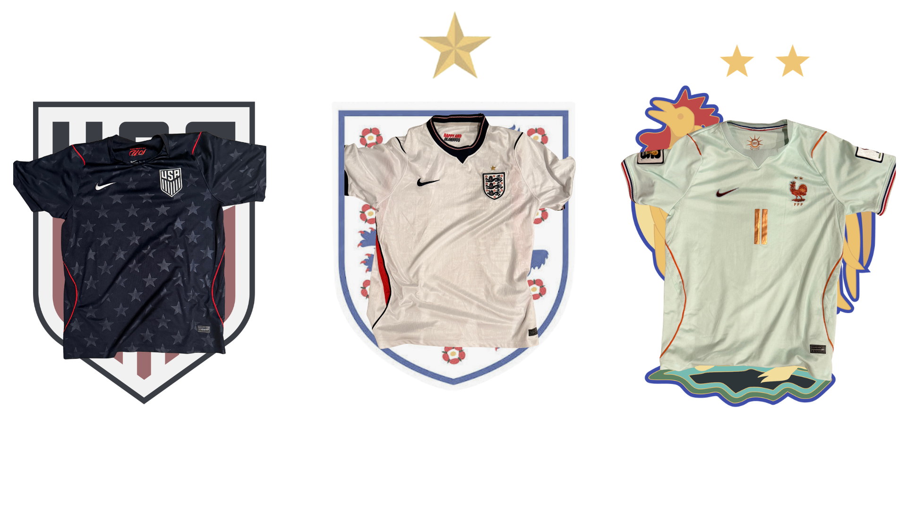
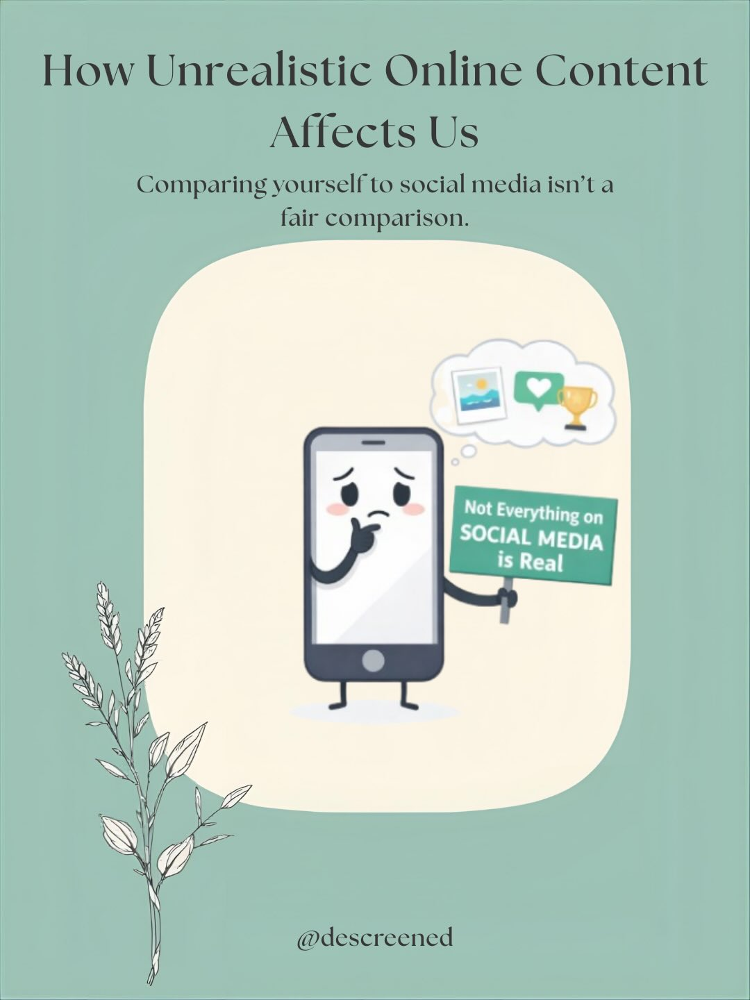

# Atharva Naveen — personal website

<p align="center">
  
</p>

<p align="center">
  <em>A living personal site: projects, writing, collections, an interactive arcade, and a 100-song mixtape.</em>
</p>

<p align="center">
  <a href="RELEASES.md">View the complete release history →</a>
</p>

The canonical website is the self-contained [`index.html`](index.html) in this repository. It is the selected shipped export of Atharva Naveen's projects and living résumé, including the interactive arcade and Connect Four route.

## A few things inside

<p align="center">
  
  
</p>

The site brings together Descreened, DECA and finance work, writing, a denim and sports archive, creative tools, and small interactive experiments. The visuals above are original work and collection media used throughout the site.

## Preview locally

From the repository root:

```sh
python3 -m http.server 4173
```

Open [http://127.0.0.1:4173/](http://127.0.0.1:4173/).

The site does not require a build step. The same canonical page is mirrored at `dist/index.html` because the hosted static-site configuration publishes `dist/`.

## Structure

- `index.html` — canonical, self-contained page structure, styles, scripts, content, and inline media
- `dist/index.html` — deployment mirror of the canonical page
- `archive/site-exports/` — historical HTML exports, including the source export used for this release
- `assets/source/` — original source media retained for future edits
- `assets/generated/` and `assets/css/`, `assets/js/` — earlier extracted site assets retained for reference

## Source media

Original media discovered on the computer and confirmed to match sections of the site is preserved in [`assets/source/`](assets/source/). This includes the denim and sports collections and the Descreened project media library.
