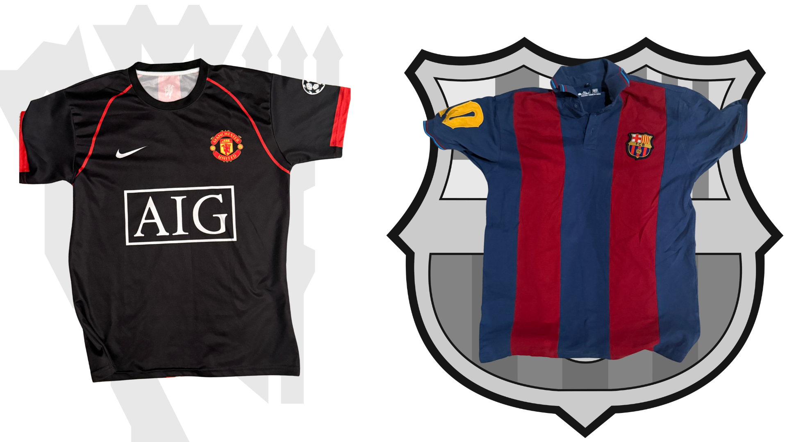
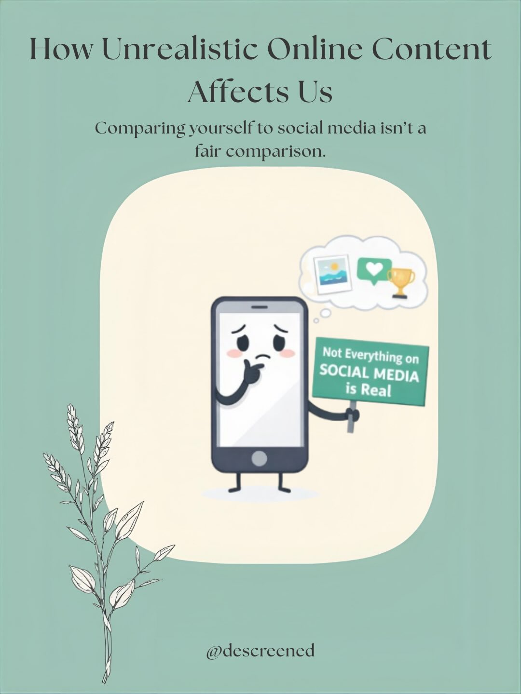
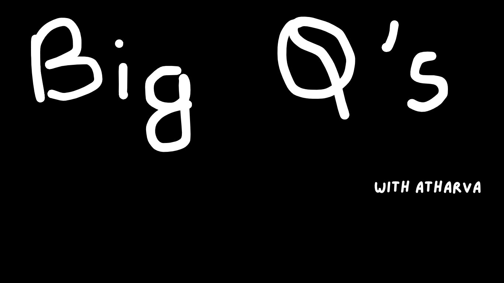

# Release history

  

  <strong>A versioned record of the site—from its first repository import to the live Paint-style experience.</strong>

The project began without Git tags or formal releases. This document assigns **retroactive semantic versions** to every commit in the repository's history so each iteration has a clean, publishable release record. The version names below are a documentation convention; the dates and commit references are the source of truth.

> **Live version:** `v1.1.2` — verified at [atharvanaveen.download](https://www.atharvanaveen.download/) on November 21, 2026.  
> **Next:** `v1.2.0` — release documentation and visual README polish, currently unreleased.

## At a glance

| Version | Date | Commit | Status | What changed |
| --- | --- | --- | --- | --- |
| `v1.1.2` | Nov 18, 2026 | [`52d8dfd`](https://github.com/Atharva333-afk/personal-site/commit/52d8dfd) | Live | Corrected the Big Questions error visual. |
| `v1.1.1` | Nov 18, 2026 | [`118f0ef`](https://github.com/Atharva333-afk/personal-site/commit/118f0ef) | Historical | Added Big Questions video and poster media. |
| `v1.1.0` | Nov 18, 2026 | [`cf6ba67`](https://github.com/Atharva333-afk/personal-site/commit/cf6ba67) | Historical | Added the Big Questions experience and popup treatment. |
| `v1.0.1` | Nov 18, 2026 | [`59ee412`](https://github.com/Atharva333-afk/personal-site/commit/59ee412) | Historical | Cleaned up README title formatting. |
| `v1.0.0` | Nov 18, 2026 | [`ed91f3f`](https://github.com/Atharva333-afk/personal-site/commit/ed91f3f) | Historical | Shipped the selected living-résumé export. |
| `v0.4.0` | Nov 16, 2026 | [`c53d53c`](https://github.com/Atharva333-afk/personal-site/commit/c53d53c) | Historical | Preserved the earlier HTML-export archive. |
| `v0.3.1` | Nov 16, 2026 | [`ba36031`](https://github.com/Atharva333-afk/personal-site/commit/ba36031) | Historical | Documented the discovered source media. |
| `v0.3.0` | Nov 16, 2026 | [`3ae777f`](https://github.com/Atharva333-afk/personal-site/commit/3ae777f) | Historical | Added original collection and Descreened media. |
| `v0.2.0` | Nov 16, 2026 | [`abddc0c`](https://github.com/Atharva333-afk/personal-site/commit/abddc0c) | Historical | Switched to the canonical self-contained page. |
| `v0.1.0` | Nov 16, 2026 | [`2733e99`](https://github.com/Atharva333-afk/personal-site/commit/2733e99) | Historical | Initial repository import. |

## v1 — the living résumé

### v1.1.2 — Big Questions visual correction

**Released November 18, 2026 · [`52d8dfd`](https://github.com/Atharva333-afk/personal-site/commit/52d8dfd)**

- Replaced the Big Questions error-popup image with the corrected asset.
- Kept the final interaction polish in the canonical `index.html`.
- This is the production snapshot currently represented by the live site.

### v1.1.1 — Big Questions media

**Released November 18, 2026 · [`118f0ef`](https://github.com/Atharva333-afk/personal-site/commit/118f0ef)**

- Added the Big Questions video and poster image.
- Gave the experience a dedicated visual entry point inside the Paint-style site.

### v1.1.0 — Big Questions interaction

**Released November 18, 2026 · [`cf6ba67`](https://github.com/Atharva333-afk/personal-site/commit/cf6ba67)**

- Added the Big Questions error-popup experience.
- Expanded the site’s interactive “tool” layer with a deliberately retro desktop visual language.

### v1.0.1 — README cleanup

**Released November 18, 2026 · [`59ee412`](https://github.com/Atharva333-afk/personal-site/commit/59ee412)**

- Corrected title formatting in the project README.
- Kept the repository documentation aligned with the shipped site.

### v1.0.0 — selected living-résumé export

**Released November 18, 2026 · [`ed91f3f`](https://github.com/Atharva333-afk/personal-site/commit/ed91f3f)**

- Shipped the chosen self-contained living-résumé site as the canonical `index.html`.
- Added the hosted static-site configuration and deployment mirror.
- Preserved extracted assets, CSS, JavaScript, and earlier generated media for reference.
- Established the Paint-era interface that anchors the live site.

### What v1 contains

The production experience is more than a portfolio page:

- **Portfolio:** 10 activity folders, including Descreened, DECA, FINEDU, Young Investors Society, Ascent Capital × IIM, TCS Building Better Futures, Speech & Debate, BPA, FCCLA, and Track & Field.
- **Collections:** an eight-pair denim archive plus a sports archive with seven featured pieces and five collection boards.
- **Arcade:** 11 playable selections—Tetris, URL Snake, PinPog, Minesweeper, 2048, Breakout, Memory, Connect Four, Maze Chase, Space Invaders, and Flappy Bird.
- **Writing:** two featured 2025 essays, including the Berkeley Haas third-place entry and IEOx top-ten entry.
- **Experiments:** browser-local guestbook and doodles, Big Questions video, an embedded JS Paint studio, and a searchable 100-song Spotify mixtape.

  
  

## v0 — preservation and reconstruction

### v0.4.0 — historical site-export archive

**Released November 16, 2026 · [`c53d53c`](https://github.com/Atharva333-afk/personal-site/commit/c53d53c)**

- Collected every unique HTML export found for earlier personal-site versions.
- Preserved the `to-know-*`, `atharva-website-*`, and `atharva-living-resume-*` lines of development.
- Added the archive guide so future work can reference prior directions without replacing the canonical live page.

### v0.3.1 — source-media documentation

**Released November 16, 2026 · [`ba36031`](https://github.com/Atharva333-afk/personal-site/commit/ba36031)**

- Added README documentation for the preserved original media.
- Made the denim, sports, and Descreened source collections discoverable.

### v0.3.0 — original media preservation

**Released November 16, 2026 · [`3ae777f`](https://github.com/Atharva333-afk/personal-site/commit/3ae777f)**

- Added the original denim and jersey photography.
- Preserved the Descreened media library—including post art, stories, event highlights, and related source files.
- Added the curated sports/collection graphics used by the current archive experience.

### v0.2.0 — canonical HTML adoption

**Released November 16, 2026 · [`abddc0c`](https://github.com/Atharva333-afk/personal-site/commit/abddc0c)**

- Replaced the earlier multi-file implementation with the supplied canonical, self-contained HTML page.
- Simplified the project so the root `index.html` became the single source for the live experience.

### v0.1.0 — initial import

**Released November 16, 2026 · [`2733e99`](https://github.com/Atharva333-afk/personal-site/commit/2733e99)**

- Created the initial personal-site repository.
- Captured the original multi-file living-résumé implementation, supporting scripts, reference exports, and project assets.

## Legacy design archive

Before the repository had formal commit history, the site went through **64 unique standalone HTML exports**. They represent far more iterations than the 10 Git commits above and are now recorded individually in the [legacy release archive register](archive/site-exports/RELEASE-ARCHIVE.md).

The register distinguishes confirmed feature evidence from filename-only clues, documents the different development branches, and makes the absence of trustworthy original dates explicit. The canonical active site remains [`index.html`](index.html).

## Publishing these releases on GitHub

Each entry above can become a GitHub Release without changing its release notes:

1. Create the listed `v*` tag at its matching commit.
2. Push the tags.
3. On GitHub, create a release from each tag and paste the corresponding section from this file.
4. Mark `v1.1.2` as the latest release; it is the currently verified production snapshot.

`v1.2.0` should be reserved for the next committed documentation-and-README update.
